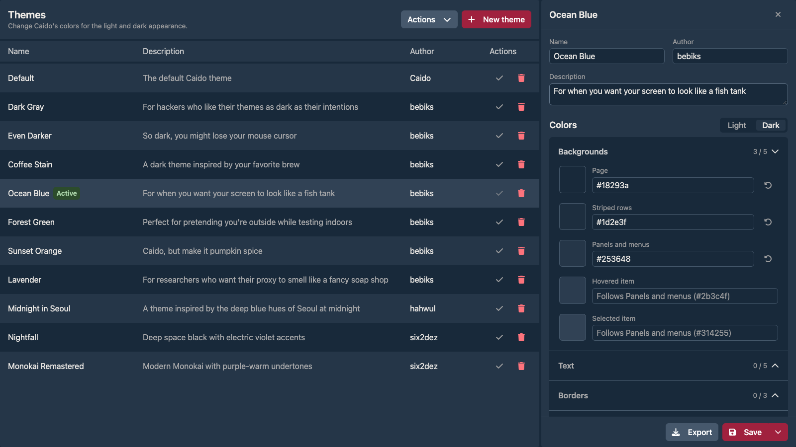

# Caido Themes
A simple plugin for managing and customizing themes in Caido.



## Requirements
Caido 0.60 or later. Themes created with an earlier version of the plugin are migrated automatically the first time it starts.

## Theme format
A theme sets Caido's design tokens, separately for the light and dark appearance. The editor groups them into backgrounds, text, borders, accent, buttons and editor syntax. Colors must be hex values.

A color that is left out keeps Caido's own value, with one exception: hover and selected backgrounds, borders and button hovers follow the theme's own backgrounds and buttons until you set them yourself.

```json
{
  "version": 2,
  "name": "Ocean Blue",
  "description": "For when you want your screen to look like a fish tank",
  "author": "bebiks",
  "tokens": {
    "--color-surface-page": { "light": "#eef8ff", "dark": "#18293a" },
    "--color-fill-primary": { "dark": "#30465a" }
  }
}
```

Themes exported by earlier versions of the plugin can still be imported.

## Installation [Recommended]
1. Open Caido and go to the Plugins page.
2. Go to the **Community Store** tab.
3. Find "Caido Themes" and click on the "Install" button.
4. Done!

## Installation [Manually]
1. Go to the [releases page](https://github.com/caido-community/CaidoThemes/releases) and download the latest version of the plugin (`plugin_package.zip` file)
2. Open Caido and go to the Plugins page.
3. Click on the "Install Package" button.
4. Select the downloaded `plugin_package.zip` file
5. Done!

## Contributing
If you have any ideas or suggestions, please open an issue or submit a pull request.
